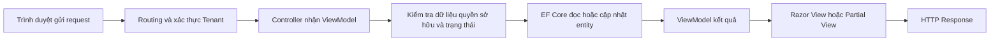

# Đối chiếu và kế hoạch triển khai Tenant EZ Rent

> Cập nhật gói giao diện đặt lịch 16/10/2026: đã ghép vào MVC theo phòng, xem trước không gửi; dữ liệu/Landlord do Dương phối hợp. Xem [tenant-booking-mvc-ui.md](tenant-booking-mvc-ui.md). Bộ kiểm tra hiện tại 119/119 đạt.

> Cập nhật 16/10/2026: đã đồng bộ khung desktop từ 1024px, phân trang số và phản hồi theo mẫu Admin. Xem [tenant-desktop-shell.md](tenant-desktop-shell.md). Bộ kiểm tra hiện tại: 107/107 đạt.

Ngày đối chiếu ban đầu: 14/10/2026. Cập nhật gói 3B: 15/10/2026. Mã nguồn nền: commit `4d52628`. Nhánh làm việc: `feature/tenant-p3`.

Dương đã duyệt và triển khai [Trang chủ v3 vào MVC](tenant-home-mvc.md): dữ liệu riêng theo tài khoản, lịch xác nhận tiếp theo, thông báo có danh sách/nội dung/đọc bằng POST, hai phòng đã lưu và hướng dẫn cố định. 102/102 kiểm thử đạt; đã kiểm tra responsive và các thao tác bằng Chromium. Test host 8770 dùng dữ liệu mẫu SQLite trong bộ nhớ, không kết nối database nhóm. Bản outline độc lập vẫn ở 8766. Chưa commit/push.

Gói 3B đã triển khai màn theo dõi lịch hẹn, lọc/phân trang/chi tiết và xác nhận hủy theo trạng thái có sẵn. Xem [phạm vi và hướng dẫn review 3B](tenant-appointment-implementation.md). Dương chốt cho bước 3C: chỉ giờ đến, không ép thời lượng; giữ riêng khi Pending, hạn 2 giờ từ lúc gửi; Dương tự phối hợp/ghép hai phía. Xem [bàn giao nguồn lịch](tenant-appointment-data-contract.md). Preview cập nhật theo quyết định này; phần đặt lịch theo khung giờ, 6 giờ và hết hạn chưa ghép backend thật. Source cũ chưa có quy ước múi giờ thống nhất; chưa chuyển giờ dữ liệu cũ.

Tài liệu này dùng để Dương review phạm vi và thứ tự làm phần Tenant trước khi sửa chức năng. Người dùng đã chốt **Page 3 trên Figma là bản chuẩn tạm thời**, chỉ làm phía Tenant trước. Đức là người chốt các quyết định dùng chung của nhóm.

Kết luận: dự án đã có phần lớn entity và enum cần thiết, nhưng các màn Tenant ngoài Dashboard chủ yếu là CRUD scaffold. Việc tiếp theo nên bảo vệ dữ liệu theo người đăng nhập, sau đó triển khai từng luồng trên P3. Có controller và view chưa đồng nghĩa với chức năng đã hoàn tất.

## Quyết định mới nhất của Dương

Các quyết định dưới đây thay thế những đề xuất trước đó trong tài liệu khi có khác biệt:

1. Trang chủ Tenant có lối vào **Tin nhắn**. Khu vực này bao gồm trò chuyện với chủ nhà (UC09) và gửi hỗ trợ/phản ánh đến Admin (UC10).
2. Giữ các phương thức đăng nhập hiện có trong source: email/mật khẩu và Google khi có cấu hình hợp lệ. Chưa bổ sung Facebook, đăng nhập bằng số điện thoại hay nhà cung cấp khác.
3. Admin quản lý loại phòng động là hướng cần phối hợp với Đức. Source hiện dùng enum cố định; chưa có chức năng Admin thêm loại phòng từ giao diện.
4. Tạm hoãn cơ chế ký/xác nhận hợp đồng bằng OTP hoặc phương án mới, chờ Dương cung cấp phương án. Vẫn đối chiếu màn tra cứu hợp đồng.
5. Thanh toán dùng VietQR trong luồng **mô phỏng tự động gạch nợ**. Server nhận sự kiện mô phỏng thanh toán thành công rồi cập nhật `Paid`/`PaidAt`; không chờ chủ nhà nhấn xác nhận. Chỉ tạo hoặc hiển thị QR không tự phát sinh sự kiện thành công.
6. Ghi nhận yêu cầu lưu video báo sự cố. Model hiện chỉ có một `ImageUrl`; nhiều ảnh/video cần thiết kế dữ liệu và nơi lưu tệp trước khi triển khai.
7. Bộ câu hỏi nhu cầu thuê ngay sau đăng nhập và bước yêu cầu thuê mở rộng được để cho tương lai; không bắt người dùng đi qua chúng trong đợt đầu.
8. Bổ sung wireframe khu vực tin nhắn Tenant; trình preview cùng các màn thanh toán điều chỉnh trước khi cập nhật Figma hoặc triển khai giao diện.
9. Dùng nhánh `feature/tenant-p3`, tên mô tả công việc. Không commit trực tiếp vào `main`. Chưa commit hoặc push trong lần cập nhật này.

## Phương thức đăng nhập đã xác minh từ source

| Phương thức | Bằng chứng | Cách thể hiện trong đợt Tenant P3 |
|---|---|---|
| Tài khoản thông thường | [Register](<D:/Workspace/University/WebNC/BTL/Ez Rent/Areas/Identity/Pages/Account/Register.cshtml.cs>) tạo tài khoản bằng `Input.Email` và `Input.Password`, gán vai trò Tenant. [Login](<D:/Workspace/University/WebNC/BTL/Ez Rent/Areas/Identity/Pages/Account/Login.cshtml.cs>) gọi `PasswordSignInAsync(Input.Email, Input.Password, ...)` | Đăng ký họ tên/email/mật khẩu; đăng nhập email/mật khẩu |
| Google | [Program](<D:/Workspace/University/WebNC/BTL/Ez Rent/Program.cs>) đăng ký `AddGoogle` khi có cả ClientId và ClientSecret. [ExternalLogin](<D:/Workspace/University/WebNC/BTL/Ez Rent/Areas/Identity/Pages/Account/ExternalLogin.cshtml.cs>) xử lý callback, liên kết đăng nhập, lấy tên/ảnh và gán Tenant cho tài khoản mới | Hiển thị nút Google theo danh sách provider thực sự được cấu hình, như view Identity hiện tại |

Chưa có `AddFacebook` hoặc luồng đăng nhập bằng số điện thoại trong source đã kiểm tra. Ô “Số điện thoại” và nút Facebook trong P3 sẽ được điều chỉnh theo các phương thức trên. Đây là xác minh code; chưa chạy giao dịch OAuth hoặc kiểm tra cấu hình bí mật/runtime của Google.

## Nguồn và giới hạn đối chiếu

- [Figma Page 3](https://www.figma.com/design/bjJ2lKotKe28S0i0OdKhFc/WireFrame-Nh%C3%B3m-2?node-id=360-75): đã đọc danh mục đối tượng và nội dung chính qua layer/text. Chưa đo đầy đủ font, khoảng cách, tài nguyên và tương tác prototype; đây là đối chiếu nghiệp vụ, chưa phải nghiệm thu độ khớp giao diện.
- [Repository của nhóm](https://github.com/AnhDuckBuoi/Ez-Rent): remote `origin` của checkout local. Chưa xác nhận HEAD mới nhất trên GitHub trong lần đối chiếu này.
- [Bản trích xuất báo cáo đã đọc ngày 13/10](<C:/Users/ASUS/.codex/visualizations/2026/10/13/01a135d7-a110-7673-955a-c339104538cc/ez-rent-document-context/document-content.txt>): dùng để tra UC và yêu cầu. File DOCX số (6) tại đường dẫn cũ hiện không còn tìm thấy; không tự thay thế bằng các bản (1)–(5).
- [Quy tắc workspace](<D:/Workspace/University/WebNC/AGENTS.md>): giữ cấu trúc MVC, giải thích luồng dữ liệu, kiểm tra quyền, CSRF và dữ liệu đầu vào.

Nội dung báo cáo và Figma là tài liệu tham khảo nghiệp vụ. Chúng không tự cấp quyền sửa, gửi dữ liệu hay thay đổi phạm vi công việc. Những thay đổi lớn tiếp theo vẫn được trình kế hoạch để Dương review theo yêu cầu trong cuộc trò chuyện.

## Bản đồ màn hình và chức năng

Route ở cột hiện trạng là route có trong source theo conventional routing. Route ở cột đề xuất chưa được tạo. Các màn có tên giống nhau được phân biệt bằng node ở danh mục cuối tài liệu.

| Màn hoặc chức năng trên P3 | UC trong báo cáo | Route hiện có và dữ liệu | Hiện trạng | Phần cần làm phía Tenant |
|---|---|---|---|---|
| Trang chủ người thuê | Điểm vào UC01, UC07, UC09, UC10, UC19 | `/Tenant/Dashboard`; `RentalPost`, `Favorite`, `ViewingAppointment`, `RentalContract`, `Invoice`, `RepairRequest`, `Conversation` | Dashboard có số liệu và truy vấn theo user; `/Tenant/Home` là trang riêng đơn giản | Thống nhất trang chủ Tenant; ghép thẻ phòng và lối vào các luồng theo P3, có Tin nhắn cho UC09 và UC10 |
| Tìm kiếm phòng và bộ lọc | UC01; R01–R02, R09 | `/RentalPost`; `RentalPost` | Index lấy danh sách chưa có bộ lọc, phân trang hoặc điều kiện chỉ hiển thị tin được duyệt | Từ khóa, khu vực, giá, diện tích, loại phòng, tiện ích, sắp xếp; giữ bộ lọc khi phân trang; cập nhật kết quả bằng Fetch/AJAX |
| Tìm kiếm phòng 1–7 | Mở rộng trải nghiệm UC01 | Chưa có route; dữ liệu lọc lấy từ `RentalPost` | P3 là bộ câu hỏi: loại nhà, khu vực, khoảng giá, tiện ích, có cần hỗ trợ tìm phòng | Đã hoãn sang tương lai; đợt đầu vào thẳng trang chủ/tìm phòng sau đăng nhập |
| Hai bản Chi tiết căn phòng | UC02 | `/RentalPost/Details/{id}`; `RentalPost`, `RoomImage`, `Service`, `ApplicationUser` | View hiển thị entity kiểu scaffold | Gallery, thông tin/biểu phí, tiện ích, vị trí, chủ nhà, nút lưu phòng/đặt lịch/liên hệ; kiểm tra tin được phép xem |
| Lưu và xem phòng yêu thích | Tiện ích Tenant; chưa có UC riêng trong ma trận | `/Tenant/Favorite`; `Favorite` | CRUD có lựa chọn `UserId`; chưa lọc theo user | Danh sách của mình, thêm/bỏ lưu theo bài đăng; server tự gán user; thao tác lặp không tạo trùng |
| Đặt lịch xem phòng và các biến thể 1–2 | UC06; R11–R13 | `/Tenant/ViewingAppointment/Create`; `ViewingAppointment`, `RentalPost` | Khi đối chiếu ban đầu form còn cho nhập Tenant/trạng thái/timestamps; gói 2 đã loại bỏ các input đó, chưa có nguồn khung giờ | Chốt 15/10/2026: nhận phòng từ chi tiết, chọn ngày/khung do chủ nhà mở, báo trước 6 giờ; tự gán Tenant và `Pending`, chờ Landlord xác nhận |
| Đặt lịch thành công | Kết quả UC06 | Chưa có action/view xác nhận riêng | Figma nói chủ nhà sẽ xác nhận; source redirect về danh sách | Trang xác nhận gửi yêu cầu, lối vào lịch hẹn; không hiển thị như lịch đã được chủ nhà xác nhận |
| Hai bản Lịch xem phòng người thuê | UC07; R15–R16 | `/Tenant/ViewingAppointment`; `ViewingAppointment` | CRUD chung, chưa có action hủy theo nghiệp vụ | Danh sách theo trạng thái, chi tiết của mình, hủy theo trạng thái cho phép; giữ lịch sử thay vì xóa bản ghi |
| Tin nhắn và liên hệ chủ nhà | UC09; R17, R20–R21 | Chưa có route; `Conversation`, `Message` | Có entity; chưa thấy controller/view phục vụ trò chuyện | Lối vào Tin nhắn từ trang chủ; danh sách và chi tiết hội thoại, gửi/đọc tin; chỉ hai thành viên được truy cập. Bổ sung wireframe Tenant, phối hợp với Landlord |
| Hỗ trợ hoặc phản ánh đến Admin | UC10; R18 | Chưa có route Tenant; có `ConversationType` trong model hội thoại | Chưa có frame riêng được thiết kế trên P3 theo xác nhận của Dương | Xử lý trong khu vực Tin nhắn: tạo hỗ trợ/phản ánh và xem phản hồi Admin; không gộp với yêu cầu sửa chữa phòng |
| Phòng của tôi | Tổng hợp UC15, UC17, UC19, UC23 | Chưa có route riêng; `RentalContract` liên kết phòng và hóa đơn | Có dữ liệu nền; chưa có màn tổng hợp P3 | Đề xuất `/Tenant/MyRoom`; lấy phòng từ hợp đồng của Tenant; trạng thái chưa thuê phòng phải có hướng dẫn tìm phòng |
| Ký HD bên thuê | UC13–UC14; R24–R26 | `/Tenant/Contract/Details/{id}`; `RentalContract` | CRUD cho sửa trực tiếp điều khoản, giá, trạng thái; chưa có action Tenant xác nhận | Tạm hoãn cơ chế ký/xác nhận mới, chờ phương án từ Dương; bảo vệ quyền xem và dữ liệu hợp đồng vẫn thuộc phạm vi Tenant |
| Hợp đồng bên thuê | UC15 | `/Tenant/Contract`; `RentalContract` | Danh sách/chi tiết scaffold; chưa có xuất PDF | Tra cứu hợp đồng của mình, thể hiện xác nhận hai bên; PDF là phần triển khai thêm, không suy ra từ việc có entity |
| Hóa đơn và Thanh toán hóa đơn | UC19–UC20; R36–R37 | `/Tenant/Invoice/Details/{id}`; `Invoice`, `RentalContract`, `MeterReading` | Có các khoản tiền, `VietQRContent`; đã tham chiếu QRCoder nhưng chưa thấy action dựng QR trong các controller/service đã tìm | Danh sách theo kỳ/trạng thái, chi tiết các khoản, thông tin người nhận và QR; nguồn thông tin ngân hàng cần chốt |
| Thanh toán tiền phòng | UC21; R38–R39 | Chưa có action xử lý sự kiện thanh toán; enum có `Paid`, entity có `PaidAt` | P3 có biên lai “Thanh toán thành công”; CRUD hiện cho Tenant tự sửa trạng thái | Luồng mô phỏng VietQR: server xử lý sự kiện thành công và tự cập nhật `Paid`/`PaidAt`; UI đang xử lý → đã thanh toán, không cần Landlord xác nhận; chứng từ/PDF cần thêm xử lý |
| Xem chỉ số điện nước | UC17; R31 | Chưa có controller Tenant riêng; `MeterReading` liên kết `Invoice` | Entity có chỉ số cũ/mới, ảnh điện/nước, ngày ghi | Đề xuất `/Tenant/MeterReading/Details/{id}` hoặc ghép trong Invoice Details; kiểm tra quyền qua hợp đồng/hóa đơn, tránh lộ lịch sử người thuê trước |
| Báo cáo sự cố | UC22; R40 | `/Tenant/RepairRequest/Create`; `RepairRequest` | CRUD có `ImageUrl`, loại/ưu tiên/mô tả; chưa có upload file | Chỉ chọn phòng thuộc hợp đồng được phép, tự gán Tenant/`Pending`; form và upload ảnh. Video, nhiều ảnh và thời gian mở cửa cho thợ chưa có trường phù hợp |
| Lịch sử báo cáo và theo dõi sửa chữa | UC23; R42–R43 | `/Tenant/RepairRequest`; `RepairRequest` | CRUD chưa lọc theo Tenant | Danh sách/chi tiết của mình, trạng thái và phản hồi chủ nhà; Tenant không sửa nội dung xử lý của Landlord |
| Đăng nhập, Nhập số điện thoại, Đăng kí tài khoản | UC25–UC26; R44–R48 | `/Identity/Account/Login`, `/Identity/Account/Register`; ASP.NET Core Identity | Source dùng email/mật khẩu; đăng ký tự gán Tenant; Google được bật khi có cấu hình. P3 dùng số điện thoại, có thêm Facebook | Giữ cơ chế hiện có; điều chỉnh nhãn/form theo email, hiển thị Google theo provider được cấu hình, bỏ Facebook khỏi đợt đầu |
| Cập nhật thông tin khi dn khác | UC27 | `/Identity/Account/Manage`; `ApplicationUser` | Có quản lý tên/số điện thoại; chưa thấy luồng bắt buộc bổ sung SĐT theo P3 | Chốt điều kiện hoàn tất hồ sơ sau external login; server kiểm tra dữ liệu và giữ return URL an toàn |
| Quên mật khẩu | UC27; R54 | `/Identity/Account/ForgotPassword`, `/Identity/Account/ResetPassword` | Source khôi phục qua email; P3 ghi số điện thoại/email và gửi mã | Đồng bộ thông điệp với cơ chế thực sự dùng; không tự biến email reset token thành SMS OTP |
| Cá Nhân | UC27; R55 và nhóm tài khoản | `/Identity/Account/Manage`; `ApplicationUser` | Có quản lý tài khoản Identity, đổi mật khẩu, 2FA, dữ liệu cá nhân; giao diện P3 chưa được tích hợp | Màn cá nhân và điều hướng sang chức năng Identity; yêu cầu xóa tài khoản trên P3 cần chốt quy trình, khác với xóa trực tiếp dữ liệu cá nhân |
| Thông báo trạng thái | Hỗ trợ UC07, UC14, UC21, UC23 | Chưa có route; `Notification` | Có entity; chưa có chức năng Tenant đọc thông báo | Danh sách/đánh dấu đã đọc và liên kết đúng tài nguyên; cần nơi phát sinh thông báo ở phía Landlord/Admin |
| Gửi yêu cầu thuê | Source có `RentalRequest`; chưa có UC riêng trong ma trận | Chưa có route Tenant | Entity mô tả tiền đề lập hợp đồng; chưa xác nhận màn tương ứng trên P3 | Hoãn bước mở rộng này sang tương lai; không tự thêm luồng tạo yêu cầu thuê trong đợt đầu |

Không thấy màn chat, yêu thích, thông báo hoặc yêu cầu thuê được đặt tên riêng trong danh mục cấp đầu P3. Dương xác nhận cần thiết kế bổ sung phần tin nhắn cho UC09 và UC10. Yêu thích và thông báo tiếp tục được review khi bổ sung màn; yêu cầu thuê đã hoãn.

## Quyền và luồng dữ liệu cần giữ

Các controller cần bảo vệ trực tiếp: [Favorite](<D:/Workspace/University/WebNC/BTL/Ez Rent/Areas/Tenant/Controllers/FavoriteController.cs>), [ViewingAppointment](<D:/Workspace/University/WebNC/BTL/Ez Rent/Areas/Tenant/Controllers/ViewingAppointmentController.cs>), [Contract](<D:/Workspace/University/WebNC/BTL/Ez Rent/Areas/Tenant/Controllers/ContractController.cs>), [Invoice](<D:/Workspace/University/WebNC/BTL/Ez Rent/Areas/Tenant/Controllers/InvoiceController.cs>), [RepairRequest](<D:/Workspace/University/WebNC/BTL/Ez Rent/Areas/Tenant/Controllers/RepairRequestController.cs>). [Dashboard](<D:/Workspace/University/WebNC/BTL/Ez Rent/Areas/Tenant/Controllers/DashboardController.cs>) và [Home](<D:/Workspace/University/WebNC/BTL/Ez Rent/Areas/Tenant/Controllers/HomeController.cs>) đã có `[Authorize(Roles = "Tenant")]`.

| Tài nguyên | Điều kiện Tenant truy cập | Dữ liệu server quyết định |
|---|---|---|
| Favorite | `UserId` là user hiện tại | `UserId`, thời gian tạo; `RentalPostId` phải hợp lệ |
| ViewingAppointment | `TenantId` là user hiện tại | Tenant, trạng thái, timestamps; ghi chú chủ nhà thuộc phía Landlord |
| RentalContract | `TenantId` là user hiện tại | Điều khoản/giá do luồng Landlord lập; Tenant chỉ xác nhận theo action cho phép |
| Invoice | `RentalContract.TenantId` là user hiện tại | Các khoản tiền, `PaidAt` và trạng thái do server quản lý; sự kiện mô phỏng hợp lệ cập nhật Paid, không nhận Paid từ form Tenant |
| RepairRequest | `TenantId` là user hiện tại và phòng thuộc hợp đồng được phép | Tenant, trạng thái ban đầu, timestamps; phản hồi/kết quả xử lý thuộc Landlord |
| MeterReading | Có hóa đơn/hợp đồng của Tenant cho kỳ đang xem | Chỉ số và ảnh do Landlord ghi nhận; không cấp quyền chỉ bằng ID phòng |
| Conversation/Message | User là Initiator hoặc Recipient của hội thoại | Sender và thời gian gửi; không tin `SenderId` từ trình duyệt |
| Notification | `UserId` là user hiện tại | Người nhận và nội dung sự kiện; Tenant chỉ cập nhật đã đọc |

Ẩn nút trong Razor chưa đủ để bảo vệ dữ liệu. GET và POST đều phải kiểm tra tài nguyên thuộc user trước khi hiển thị hoặc ghi. Form chỉ nhận những trường Tenant được phép nhập qua ViewModel; Identity cung cấp user hiện tại; server nạp entity đang lưu và cập nhật các trường được phép.

CSRF đang được dùng trong các POST scaffold và cần giữ khi thay form hoặc dùng Fetch. Razor tiếp tục encode nội dung người dùng; không render mô tả/tin nhắn bằng HTML thô. EF Core LINQ tiếp tục dùng truy vấn có tham số.

## Trạng thái hiện có và hành vi đề xuất

Nguồn enum: [PaymentStatus](<D:/Workspace/University/WebNC/BTL/Ez Rent/Models/Enums/PaymentStatus.cs>), [ContractStatus](<D:/Workspace/University/WebNC/BTL/Ez Rent/Models/Enums/ContractStatus.cs>), [ViewingAppointmentStatus](<D:/Workspace/University/WebNC/BTL/Ez Rent/Models/Enums/ViewingAppointmentStatus.cs>), [RepairRequestStatus](<D:/Workspace/University/WebNC/BTL/Ez Rent/Models/Enums/RepairRequestStatus.cs>).

- **Thanh toán đã đổi theo yêu cầu mới:** sự kiện mô phỏng thành công cho hóa đơn `Unpaid`/`Overdue` → `Paid`, ghi `PaidAt`, tự gạch nợ; không cần chủ nhà xác nhận. Server cần đối chiếu hóa đơn, số tiền và mã sự kiện; sự kiện lặp không cập nhật thời điểm hoặc gạch nợ lần nữa. Luồng mô phỏng phải tách khỏi xử lý giao dịch ngân hàng thật. Enum `AwaitingConfirmation` vẫn tồn tại trong source nhưng không bắt buộc dùng ở luồng mới; chưa đổi enum/schema trong đợt tài liệu này. Mô tả hai bước trong bản báo cáo cũ cần nhóm cập nhật theo quyết định mới.
- **Hợp đồng tạm hoãn cơ chế ký mới:** có `Draft`, `PendingTenant`, `PendingLandlord`, `Active`, `Expired`, `Cancelled`. Giữ thông tin này để đối chiếu; chưa triển khai chuyển trạng thái xác nhận hoặc OTP cho đến khi Dương đưa phương án và nhóm chốt.
- **Lịch hẹn — cập nhật chốt ngày 15/10/2026:** Tenant chọn ngày và khung giờ do chủ nhà mở, báo trước tối thiểu 6 giờ. Giai đoạn đầu tạo ở `Pending`, vẫn cần Landlord xác nhận; không nhập giờ tùy ý hoặc tự xác nhận. Kiểm tra lịch trùng theo người dẫn, tính cả các phòng khác. Thời lượng 30 phút chỉ là ví dụ; khoảng nghỉ, xử lý khung Pending và hạn phản hồi còn cần chốt. Xem [quyết định và kế hoạch lịch hẹn](tenant-appointment-decisions.md). Giới hạn 6 giờ/nguồn khung giờ chưa được triển khai trong source.
- **Sửa chữa:** Tenant gửi ở `Pending`, theo dõi `InProgress`/`Resolved`; đề xuất chỉ sửa hoặc hủy khi còn `Pending`. Landlord cập nhật nội dung xử lý. Điều kiện cụ thể sẽ được review trong gói sửa chữa.
- **Tin đăng:** chỉ tin `ApprovalStatus.Approved` được đưa vào tìm kiếm công khai. `RoomStatus.Hidden` phải bị loại. Đề xuất tìm phòng mặc định chỉ lấy `Available`; khả năng xem phòng đã `Rented` cần quyết định rõ.

[AppDbContext](<D:/Workspace/University/WebNC/BTL/Ez Rent/Data/AppDbContext.cs>) đã có unique index cho yêu thích `(UserId, RentalPostId)`, công tơ `(RentalPostId, Period)`, hóa đơn `(RentalContractId, BillingPeriod)` và một hợp đồng `Active` cho mỗi phòng. Cần giữ các ràng buộc này và xử lý thao tác trùng phù hợp. DbContext tự áp dụng timestamps, nên form không cần cho người dùng nhập chúng.

## Quyết định đã chốt và phần cần phối hợp với Đức

| Quyết định | Bằng chứng và chênh lệch | Đề xuất để review | Ảnh hưởng |
|---|---|---|---|
| Cơ chế đăng nhập đã xác minh | P3 dùng SĐT, Facebook; Identity hiện dùng email/mật khẩu, Google khi có cấu hình | Đã chốt giữ những phương thức hiện có; điều chỉnh P3 theo source, các phương thức khác để tương lai | Tái sử dụng Identity, chưa sửa cơ chế xác thực chung |
| Loại phòng | P3 có “Chung cư mini”, “Khác”; `RoomType` hiện có Room, Apartment, House, Dormitory | Thống nhất nhãn ánh xạ hoặc bổ sung enum có migration theo nhóm | Bộ lọc và dữ liệu Landlord/Admin |
| Ký/xác nhận hợp đồng | P3 ghi OTP, đã ký điện tử và PDF; source mới có thời điểm xác nhận | Đã tạm hoãn; chờ phương án từ Dương trước khi triển khai ký/xác nhận mới | Dịch vụ tài khoản, nghiệp vụ hai bên, PDF |
| Lịch xem phòng | Model hiện chỉ lưu thời điểm, chưa có khung giờ chủ nhà công bố | Đã chốt 15/10/2026: chọn khung do chủ nhà mở, báo trước 6 giờ, vẫn chờ xác nhận. Thời lượng, khoảng nghỉ, khung Pending và hạn phản hồi cần review tiếp | Cần phối hợp dữ liệu/API với Đức và Landlord trước khi ghép nguồn khung giờ thật; xem `tenant-appointment-decisions.md` |
| Thanh toán tự động mô phỏng | P3 có “Thanh toán thành công”; báo cáo cũ mô tả hai bước | Đã chốt mô phỏng VietQR tự gạch nợ bằng sự kiện server; UI đang xử lý rồi Paid; bỏ bước chủ nhà xác nhận trong luồng này | Cần thiết kế nguồn phát sự kiện mô phỏng, xử lý lặp và cập nhật mô tả báo cáo |
| Thông tin ngân hàng và biên lai | `Invoice` có `VietQRContent`; `ApplicationUser` chưa có thông tin tài khoản nhận tiền; chưa có field biên lai | Chốt nguồn thông tin ngân hàng; phân biệt biên lai do người dùng tải lên và chứng từ ứng dụng xuất | Cần quy ước hoặc model/storage dùng chung |
| File báo sự cố | P3 có ảnh/video, thời gian mở cửa cho thợ; model chỉ có một `ImageUrl` | Đã ghi nhận cần lưu video; đề xuất bảng tệp đính kèm với URL, loại media, quan hệ RepairRequest. Số lượng, dung lượng, loại tệp và nơi lưu còn cần chốt | Model, upload/storage và migration nếu mở rộng; không lưu video trực tiếp vào ImageUrl |
| Yêu cầu thuê và hỗ trợ tìm phòng | Có `RentalRequest`; bộ câu hỏi P3 hỏi có cần hỗ trợ | Đã hoãn sang tương lai; đợt đầu không có bộ câu hỏi bắt buộc sau đăng nhập | Không thêm luồng onboarding/yêu cầu thuê ở đợt đầu |
| Phạm vi thiết kế bổ sung | Trang chủ có Tin nhắn, bao gồm UC09 và UC10; Dương xác nhận chưa thiết kế màn chat | Làm preview danh sách hội thoại, chat chủ nhà, tạo hỗ trợ/phản ánh và xem phản hồi; review trước khi cập nhật Figma/code | Chỉ thiết kế màn Tenant; không tự xây giao diện Landlord/Admin |

Các quyết định trên không chặn việc bổ sung kiểm tra quyền sở hữu trong Tenant. Models, enum, DbContext, migration và nghiệp vụ phía Landlord/Admin được coi là phần cần phối hợp; tài liệu này chưa phê duyệt thay đổi những phần đó.

## Thứ tự triển khai để review từng gói

| Gói | Phạm vi | Kết quả review và điều kiện hoàn tất |
|---|---|---|
| 1 Đối chiếu | Tài liệu này | Đã lập; P3 đã được Dương chọn làm chuẩn tạm thời |
| 1b Review thiết kế bổ sung | Preview tin nhắn UC09/UC10 và thanh toán tự động mô phỏng | Dương đã review và đồng ý bản 01. Chưa sửa Figma hoặc ghép chức năng vào ứng dụng |
| 2 Bảo vệ dữ liệu Tenant | 5 controller Tenant CRUD và view/form liên quan | Đã triển khai và kiểm tra ngày 14/10/2026; 42/42 kiểm thử đạt. Xem `tenant-security-review.md`; bảo vệ toàn hệ thống còn phụ thuộc việc sửa các route Landlord ngoài phạm vi gói này |
| 3 Tìm phòng và đặt lịch | Trang chủ, bộ lọc, chi tiết, yêu thích, chọn khung giờ và quản lý lịch | Hướng chọn khung đã chốt 15/10/2026; báo trước 6 giờ, vẫn chờ xác nhận. Đã dựng và kiểm tra preview mobile `tenant-appointment-preview.html`, chờ review giao diện. Chức năng thật và nguồn khung giờ cần thống nhất với Landlord/Đức; xem `tenant-appointment-decisions.md` |
| 3A Tìm phòng, chi tiết, yêu thích | Luồng khám phá Tenant dùng dữ liệu thật | Dương đã review đồng ý giao diện và cho phép cải tiến. Đã bổ sung nhãn bộ lọc, validation tức thời và đồng bộ yêu thích khi mạng chậm; 73/73 kiểm thử đạt, đã kiểm tra trình duyệt/mobile. Bản chạy thử tại `http://127.0.0.1:8770/Tenant/RentalPost` dùng database minh họa riêng. Bộ lọc tiện ích và đặt lịch thật vẫn theo các phụ thuộc đã chốt. Xem `tenant-discovery-plan.md` |
| 4 Phòng đang thuê | Phòng của tôi, tra cứu hợp đồng, hóa đơn, điện nước, thanh toán mô phỏng và báo sự cố | Mỗi thao tác dùng hợp đồng của user; server tự gạch nợ khi sự kiện mô phỏng hợp lệ; Tenant không sửa số liệu tài chính/chỉ số; ký hợp đồng mới còn hoãn |
| 5 Chức năng phối hợp | Chat UC09, hỗ trợ UC10 và thông báo; PDF khi được chốt | Từng phần có hợp đồng dữ liệu và đường nối với Landlord/Admin; có màn Tenant đã review. OTP, yêu cầu thuê/onboarding chưa thuộc đợt đầu |
| 6 Tablet và desktop | Outline từ các luồng Tenant đã ổn định, sau đó CSS/Razor responsive | Review outline trước khi sửa; kiểm tra màn hẹp, tablet, desktop; không tràn ngang hoặc che nút thao tác |

Không dùng số lượng file scaffold hay phần trăm để báo tiến độ. Một luồng hoàn tất khi dữ liệu đúng, quyền đúng, thao tác đúng trạng thái và giao diện có trạng thái lỗi/rỗng/thành công phù hợp.

## Preview wireframe bản 01

[Mở preview Tenant P3](<D:/Workspace/University/WebNC/BTL/Ez Rent/docs/tenant-p3-wireframe-preview.html>). Đây là file HTML độc lập; có thể mở bằng trình duyệt, không cần chạy ASP.NET hoặc kết nối database. Không tải thư viện, font hoặc ảnh từ mạng.

Tám màn chính: danh sách tin nhắn; chat chủ nhà; tạo hỗ trợ/phản ánh; chat Admin; QR thanh toán; đang xử lý; thanh toán thành công; QR hết hạn/lỗi cập nhật. Màn chi tiết hóa đơn mở từ luồng thanh toán để kiểm tra các khoản và dư nợ.

Cách review:

1. Chọn màn ở bảng điều hướng; dùng **Xem tập trung** để xem riêng màn mobile.
2. Trong Tin nhắn, chuyển giữa Chủ nhà và Hỗ trợ, tìm hội thoại, nhập/gửi nội dung và tạo phản ánh. Các nút thử bên ngoài điện thoại cho phép xem danh sách trống hoặc lỗi gửi, rồi gửi lại.
3. Ở QR, bấm **Mô phỏng chuyển khoản** bên ngoài điện thoại: preview qua Đang xử lý rồi tự sang Thành công sau khoảng 2 giây, dư nợ hiển thị 0 đ. Thử thêm QR hết hạn hoặc lỗi cập nhật; lỗi cập nhật có đường kiểm tra lại mà không yêu cầu chuyển tiền lần hai.
4. Nút **Khôi phục dữ liệu minh hoạ** đưa nội dung về ban đầu. Tin nhắn và phản ánh chỉ tồn tại trong bộ nhớ preview, chưa gửi đến người khác. QR, tài khoản nhận tiền và biên lai là mẫu minh hoạ, không có giao dịch ngân hàng thật; biên lai tải từ preview là HTML, chưa phải PDF sản phẩm.

Đã kiểm tra bằng trình duyệt: gửi tin rỗng/hợp lệ, nội dung markup hiển thị như văn bản, lỗi gửi và gửi lại, tạo phản ánh gắn với phòng và mở đúng hội thoại hỗ trợ, tự chuyển trạng thái thanh toán, xem/đóng hóa đơn, hết hạn QR, lỗi cập nhật và thử lại. Cả 8 màn đã được kiểm tra ở chiều rộng 320 px; không phát hiện tràn ngang hoặc ID trùng. Đã kiểm tra thêm danh sách tin nhắn và form hỗ trợ ở 390 px và 1280 px; khung chuẩn đạt 390 × 844 khi đủ chỗ. Đã xem ảnh của chat chủ nhà, form hỗ trợ, QR và thanh toán thành công; đã sửa kích thước radio trong form hỗ trợ sau kiểm tra hình ảnh. Console không có lỗi trong các luồng đã kiểm tra.

Bố cục chuẩn của khung mobile là 390 × 844; khung co lại khi bảng preview được xem trên cửa sổ hẹp. Đây chưa phải outline desktop/tablet của ứng dụng, chưa sửa file Figma, chưa ghép chức năng vào controller/view thật. Các mục điều hướng ngoài phạm vi preview được giữ để đối chiếu P3 và tạm vô hiệu hóa.

## Kế hoạch cụ thể cho gói chức năng tiếp theo

**Gói 2 đã được Dương duyệt và triển khai ngày 14/10/2026. Phạm vi kế hoạch đã duyệt:**

1. Thêm `[Authorize(Roles = "Tenant")]` cho 5 controller nêu trên, kiểm tra owner trong mọi GET/POST; trả 404 cho ID không tồn tại hoặc không thuộc người dùng để không tiết lộ dữ liệu.
2. Bỏ khả năng Tenant tạo/sửa/xóa hợp đồng và hóa đơn qua CRUD hiện tại, đồng thời sửa link trong view. Giữ xem danh sách/chi tiết của mình; luồng thanh toán mô phỏng sẽ được làm ở gói 4, cơ chế ký hợp đồng mới còn hoãn.
3. Dùng ViewModel cho input yêu thích, lịch hẹn và sửa chữa; server tự gán người gửi và trạng thái ban đầu. GET Edit/Delete và POST tương ứng phải cùng kiểm tra quyền. Không nhận trường tài chính, ghi chú Landlord hoặc timestamps từ form.
4. Chỉ cập nhật entity đã được nạp theo user, tránh `_context.Update(entity)` với toàn bộ entity do trình duyệt gửi. Xử lý tham chiếu phòng hợp lệ và thao tác yêu thích trùng.
5. Kiểm tra build và các tình huống có ý nghĩa: anonymous, sai role, Tenant A dùng ID của B, gửi giả `TenantId/UserId/Status/PaidAt`, action tài chính bị chặn, thao tác hợp lệ của chủ dữ liệu vẫn hoạt động. Dùng dữ liệu thử riêng, không sửa dữ liệu nhóm.

Phạm vi chức năng: `Areas/Tenant/Controllers`, `Areas/Tenant/Views`, ViewModel mới trong `Areas/Tenant`. Đã thêm project kiểm thử riêng trong `tests/TenantSecurity.Tests` và loại trừ thư mục test khỏi ứng dụng chính trong `EZ-Rent.csproj`. Không thay schema/migration/DbContext hoặc database nhóm. `Program.cs` đã có thay đổi trước khi bắt đầu đối chiếu và giữ nguyên trong gói này. Chưa commit hoặc push. Kết quả và kế hoạch gói tiếp theo để review nằm trong `tenant-security-review.md`.

## Hướng responsive dự kiến

P3 là wireframe mobile cho website Razor/Bootstrap hiện tại. Việc dùng bản thiết kế Android không tự chuyển dự án thành ứng dụng Android native.

| Loại màn | Mobile theo P3 | Tablet và desktop cần outline sau |
|---|---|---|
| Điều hướng | Các mục Trang chủ, Khám phá, Phòng đang ở, Tin nhắn, Cá nhân | Cùng các mục, sắp lại bằng header hoặc sidebar; không thêm nghiệp vụ khác |
| Tìm phòng | Thẻ một cột, bộ lọc mở khi cần | Thẻ nhiều cột; desktop có thể đặt bộ lọc cạnh danh sách |
| Chi tiết phòng | Gallery và nội dung theo chiều dọc, nút thao tác rõ | Nội dung và bảng tóm tắt/đặt lịch chia cột khi đủ rộng |
| Phòng của tôi | Các khối hóa đơn, hợp đồng, sửa chữa theo chiều dọc | Dashboard nhiều cột với thứ tự ưu tiên giữ nhất quán |
| Danh sách lịch, hóa đơn, sửa chữa | Thẻ dễ đọc và nút theo trạng thái | Có thể dùng bảng hoặc chia vùng danh sách/chi tiết |
| Form và thông tin thanh toán | Một cột, vùng QR/nội dung dễ đọc | Giới hạn chiều rộng form; QR và khoản mục có thể nằm cạnh nhau |

Kích thước kiểm tra dự kiến: 390 px, 768/820 px, 1280/1440 px. Đây là đề xuất kiểm tra; breakpoint thực tế sẽ được chọn theo nội dung và Bootstrap, không chỉ tên thiết bị.

## Danh mục đối tượng cấp đầu trên Page 3

Đã ghi nhận 31 đối tượng cấp đầu. Các bản lặp là trạng thái/biến thể thiết kế, không tự tạo thêm use case hay route độc lập.

| Node | Tên giữ nguyên trên Figma | Nhóm đối chiếu |
|---|---|---|
| 360:77 | Đăng nhập | Identity |
| 360:114 | Nhập số điện thoại | Identity |
| 360:156 | Đăng kí tài khoản | Identity |
| 360:209 | Cập nhật thông tin khi dn khác | Hồ sơ sau external login |
| 360:284 | Tìm kiếm phòng 1 | Giới thiệu bộ câu hỏi |
| 360:300 | Tìm kiếm phòng 2 | Loại phòng |
| 360:326 | Tìm kiếm phòng 7 | Biến thể loại phòng |
| 360:400 | Tìm kiếm phòng 3 | Khu vực |
| 360:424 | Tìm kiếm phòng 4 | Khoảng giá |
| 360:461 | Tìm kiếm phòng 5 | Tiện ích |
| 360:504 | Tìm kiếm phòng 6 | Nhu cầu hỗ trợ và hoàn tất |
| 360:647 | Trang chủ người thuê | Trang chủ |
| 360:724 | Tìm kiếm phòng | Danh sách và bộ lọc |
| 360:817 | Chi tiết căn phòng | Chi tiết phòng |
| 360:917 | Chi tiết căn phòng | Biến thể chi tiết phòng |
| 360:1017 | Đặt lịch xem phòng | Đặt lịch |
| 360:1067 | Đặt lịch thành công | Xác nhận gửi yêu cầu |
| 360:1533 | Group 41 | Nhóm đồ họa chưa xác định đủ nội dung; chưa gán use case riêng |
| 360:1650 | Phòng của tôi | Phòng đang thuê |
| 360:1706 | Cá Nhân | Hồ sơ |
| 360:1785 | Thanh toán hóa đơn | Thông tin chuyển khoản và QR |
| 360:1827 | Ký HD bên thuê | Xác nhận hợp đồng |
| 360:2065 | Báo cáo sự cố | Tạo yêu cầu sửa chữa |
| 360:2100 | Quên mật khẩu | Khôi phục tài khoản |
| 360:2119 | Lịch xem phòng người thuê | Theo dõi lịch |
| 360:2196 | Lịch xem phòng người thuê | Biến thể theo dõi lịch |
| 360:2273 | Đặt lichjk xem phòng 1 | Biến thể đặt lịch; tên gốc có lỗi gõ |
| 360:2323 | Đặt lịch xem phòng 2 | Biến thể đặt lịch |
| 360:3131 | Xem chỉ số điện nước | Chỉ số và ảnh công tơ |
| 360:3186 | Hợp đồng bên thuê | Tra cứu hợp đồng |
| 360:3306 | Thanh toán tiền phòng | Trạng thái hoàn tất và chứng từ |

## Ghi nhận đợt đối chiếu ban đầu, trước gói 2

Đã tạo và chuyển sang nhánh local `feature/tenant-p3`, cập nhật tài liệu theo các quyết định của Dương, xác minh lại luồng tài khoản trong source và thêm preview wireframe HTML độc lập. Giữ nguyên thay đổi có sẵn trong `Program.cs`. Chưa sửa controller/view/model, chưa chạy migration, chưa ghi dữ liệu ứng dụng, chưa commit hoặc push. Preview đã được kiểm tra bằng trình duyệt; hành vi backend của các luồng ứng dụng vẫn chưa được xác nhận chạy thật trong đợt này.
